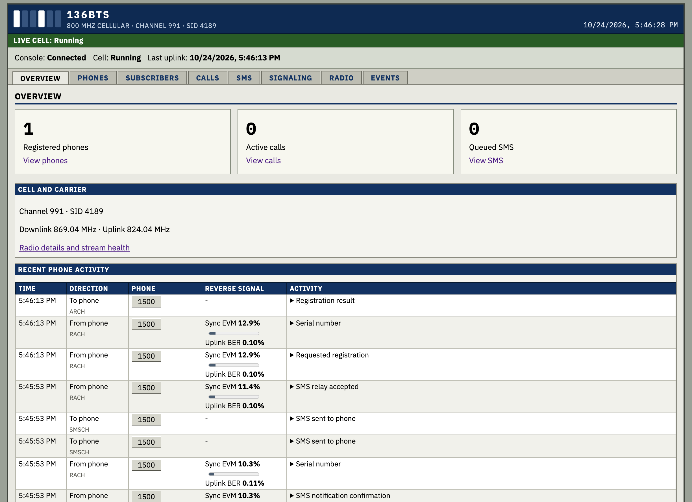

[](https://github.com/chrismoos/136-bts/actions/workflows/ci.yml)
[](https://doc.rust-lang.org/edition-guide/rust-2024/)
[](LICENSE)

An IS-136 (TDMA) cell for SDR, written in Rust. It supports phone calls and SMS, and includes a web dashboard.



> Transmit only in a shielded setup or with authorization for the spectrum in use.

## Quick start

`config/uhd.yaml` opens the first USRP B200/B210 found. Set `cell.channel` and `cell.sid` in it to the channel and system ID the cell should use, then run:

```sh
cargo run --release -p bts136 --features uhd -- --run config/uhd.yaml
```

Open the dashboard at <http://127.0.0.1:8090>. Press Ctrl+C to stop. See [Getting started](docs/getting-started.md) for the full setup.

## Status

See [Status and limitations](docs/status-and-limitations.md) for what is tested and what is not supported.

## Hardware

- A supported [radio](docs/configuration.md#radio): USRP B200 or B210, LimeSDR, bladeRF, a SoapySDR device, or a remote radio daemon
- [IS-136 phones](docs/status-and-limitations.md). The Nokia 6160 and Motorola V60t are tested

Radio access uses [sdr-hal](https://github.com/chrismoos/sdr-hal) ([crates.io](https://crates.io/crates/sdr-hal)).

## Setup

1. Install Rust with rustup.
2. Install the build tools.
   - Ubuntu: `sudo apt install build-essential pkg-config protobuf-compiler libclang-dev`
   - macOS: `xcode-select --install`, then `brew install pkg-config protobuf`
3. Install the driver for the radio, from the table below.
4. Update `config/uhd.yaml` for the radio and cell, then run the command under [Quick start](#quick-start). Use the feature for the configured radio.

| Radio | Feature | Ubuntu | macOS |
| --- | --- | --- | --- |
| USRP B200 or B210 | `uhd` | `sudo apt install libuhd-dev uhd-host`, then `sudo uhd_images_downloader` | `brew install uhd`, then `uhd_images_downloader` |
| LimeSDR | `lime` | `sudo apt install liblimesuite-dev` | `brew install limesuite` |
| bladeRF | `bladerf` | `sudo apt install libbladerf-dev` | `brew install libbladerf` |
| SoapySDR device | `soapy` | `sudo apt install libsoapysdr-dev` and the device's module | `brew install soapysdr` |
| Remote radio daemon | `network` | Nothing extra | Nothing extra |

[SIP calling](docs/sip.md) is optional and needs the `sip-backend` feature and `libre-dev` on Ubuntu or `brew install libre` on macOS. Combine features with commas, for example `--features uhd,sip-backend`.

## Documentation

- [Getting started](docs/getting-started.md)
- [Configuration](docs/configuration.md)
- [SIP calling](docs/sip.md)
- [SMS hub](docs/sms-hub.md)
- [gRPC interface](docs/api.md)
- [Troubleshooting](docs/troubleshooting.md)

## Development

```sh
cargo fmt --all
cargo clippy --workspace --tests -- -D warnings
cargo test --workspace --all-targets --release
```

## License

136BTS is licensed under Apache-2.0. See [LICENSE](LICENSE). Third-party dependencies and bundled assets retain their respective licenses.
